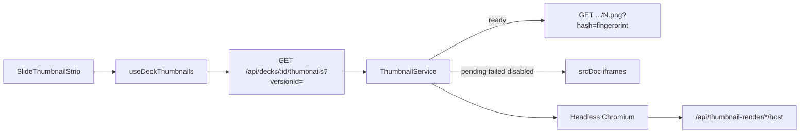

# Sandbox-backed thumbnails

Ark renders slide thumbnails through a headless Chromium pipeline that loads the
same preview HTML and CSP path as the sandbox host, then caches per-slide PNGs
keyed by immutable deck version identity.

## Flow

1. Saving or generating a deck version warms the queue via `enqueueForDeckVersion`.
2. The shell polls `GET /api/decks/:id/thumbnails?versionId=…`.
3. While status is `pending`, the strip keeps script-stripped `srcDoc` iframes.
4. When status is `ready`, the strip swaps in cached PNG `` URLs.
5. `failed` / `disabled` / image `onError` fall back to the same `srcDoc` path.

## Cache identity

Thumbnails are cached under `data/thumbnails/` (or `ARK_THUMBNAIL_CACHE_DIR`) by:

- immutable `versionId`
- a **full SHA-256 fingerprint** of the version's `runtimeManifestHash`

PNG URLs include that fingerprint as the required `hash` query parameter. A
missing, truncated, or mismatched hash returns 404. Changing either the version
id or the runtime manifest produces a new cache key.

## Limits and isolation

| Control           | Default  | Notes                                    |
| ----------------- | -------- | ---------------------------------------- |
| Viewport          | 1280×720 | Matches the preview reference canvas     |
| Output PNG        | 480×270  | Scaled from the viewport                 |
| Max slides        | 40       | Rejected before Chromium opens a page    |
| Deck timeout      | 45s      | Page + session disposed on failure       |
| Per-slide timeout | 3s       | Goto + screenshot                        |
| Max PNG bytes     | 1.5 MB   | Per slide                                |
| Settle delay      | 40ms     | Max per-slide wait after adaptive settle |
| Queue concurrency | 1        | Serialized by default                    |
| Queue pending     | 20       | Extra jobs stay `pending` until drain    |
| Cache entries     | 200      | Oldest directories evicted               |

The settle delay is a fallback budget around the adaptive font/image/frame settle
path. It was lowered from 120ms → 80ms → 40ms after byte-identical PNG comparisons
on plain/reveal fixtures (see `benchmarks/TUNING.md`); that is not a broad visual
QA pass across arbitrary decks. Adaptive settle uses a single
`requestAnimationFrame` after fonts/images.

The preview and thumbnail viewport changed from 1600×900 to 1280×720 with the
manual-editing coordinate model. Fixed-pixel decks may wrap or trigger media
queries differently; use proportional sizing for viewport-independent layout.

Network access during render is blocked by the same sandbox CSP (`connect-src
'none'`, `form-action 'none'`, `object-src 'none'`). Render routes are
loopback-only and require a process-local `x-ark-thumbnail-render-secret`.

Ark does **not** claim a portable in-process CPU/RSS hard cap. Enforce host or
container cgroup quotas around the API process when running untrusted decks at
scale. Timeouts always dispose the Chromium page target.

## Configuration

| Variable                          | Purpose                                                                                                                                                                    |
| --------------------------------- | -------------------------------------------------------------------------------------------------------------------------------------------------------------------------- |
| `ARK_THUMBNAIL_RENDERER=off`      | Disable the renderer; clients keep `srcDoc` fallback                                                                                                                       |
| `ARK_CHROMIUM_PATH`               | Chromium/Chrome binary for rendering and browser smoke                                                                                                                     |
| `ARK_CHROMIUM_NO_SANDBOX=true`    | Always launch with `--no-sandbox` (skip sandboxed probe); also accepts `1` / `yes` / `on`. When unset, try sandboxed first and fall back to `--no-sandbox` if launch fails |
| `ARK_THUMBNAIL_CACHE_DIR`         | PNG cache root (default `data/thumbnails`)                                                                                                                                 |
| `ARK_THUMBNAIL_QUEUE_CONCURRENCY` | Renderer queue concurrency (positive integer, default `1`)                                                                                                                 |
| `ARK_THUMBNAIL_SETTLE_MS`         | Per-slide settle delay (non-negative integer, default `40`)                                                                                                                |

## Observability

| Event                                 | When                                                                                                   |
| ------------------------------------- | ------------------------------------------------------------------------------------------------------ |
| `thumbnail.status`                    | Status poll response                                                                                   |
| `thumbnail.render.succeeded`          | Deck render completed                                                                                  |
| `thumbnail.render.failed`             | Deck render failed / timed out                                                                         |
| `thumbnail.render.aborted`            | In-flight render superseded                                                                            |
| `thumbnail.queue.saturated`           | Pending queue hit its bound                                                                            |
| `thumbnail.queue.failed`              | Unexpected queue exception                                                                             |
| `thumbnail.queue.aborted`             | Running warm aborted as obsolete                                                                       |
| `thumbnail.chromium.started`          | Chromium pool process ready (`sandboxMode`)                                                            |
| `thumbnail.chromium.sandbox_fallback` | Sandboxed launch failed with a recognized sandbox error; retrying with `--no-sandbox` (`failureClass`) |

## Related code

- `apps/api/thumbnails/` — Chromium pool, render host, cache, service
- `apps/api/routes/thumbnails.ts` — public status + PNG routes
- `apps/web/src/hooks/useDeckThumbnails.ts` — client polling
- `apps/web/src/components/SlideThumbnailStrip.tsx` — image / `srcDoc` strip
- `scripts/smoke-thumbnails.ts` — renderer-enabled UI browser smoke (CI `smoke-extended` on main pushes; API renderer coverage is `test:live-chromium` on the same trigger)
