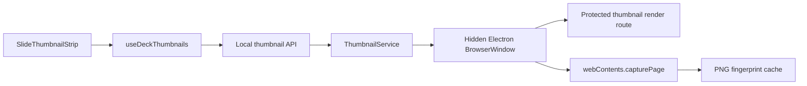

# Electron thumbnail rendering

Ark renders slide thumbnails with a hidden sandboxed Electron `BrowserWindow` and `webContents.capturePage()`. It does not spawn or discover a system Chrome/Chromium binary.

## Flow

1. Saving or generating a deck version enqueues thumbnail warming.
2. The renderer polls the local status endpoint.
3. A hidden `BrowserWindow` loads the same processed preview document used by Ark's deck runtime.
4. The main process navigates slides, waits for fonts/images/animation frames, captures the page, and resizes it to 480×270.
5. The strip swaps from script-stripped `srcDoc` fallbacks to cached PNGs when ready.

## Isolation

- The thumbnail window uses `contextIsolation: true`, `sandbox: true`, and `nodeIntegration: false`.
- It has an ephemeral Electron session partition with all non-app-origin requests denied.
- Render routes are loopback-only and require a process-local secret header.
- Deck CSP keeps `connect-src 'none'`, `form-action 'none'`, and `object-src 'none'`.
- The window and preview token are destroyed after every render, failure, timeout, or abort.

## Limits

| Control           | Value    |
| ----------------- | -------- |
| Viewport          | 1280×720 |
| Output PNG        | 480×270  |
| Max slides        | 40       |
| Deck timeout      | 45s      |
| Per-slide timeout | 3s       |
| Max PNG bytes     | 1.5 MB   |
| Queue concurrency | 1        |
| Queue pending     | 20       |
| Cache entries     | 200      |

The fingerprint cache is stored under Electron `userData/thumbnails`. Immutable version ids and full runtime-manifest hashes form cache identity.

## Related code

- `apps/desktop/electron/thumbnail-renderer.ts` — native renderer
- `apps/api/thumbnails/service.ts` — queue and cache orchestration
- `apps/api/thumbnails/render-host.ts` — protected preview document
- `apps/desktop/src/hooks/useDeckThumbnails.ts` — renderer polling
- `apps/desktop/src/components/SlideThumbnailStrip.tsx` — PNG / `srcDoc` presentation
